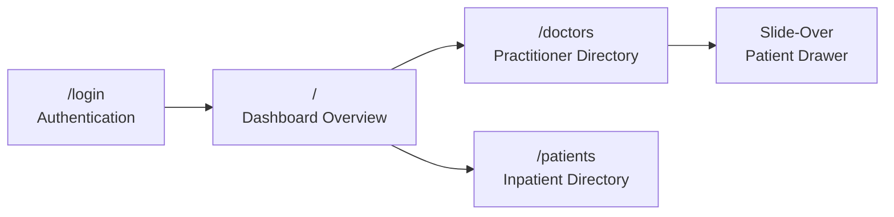

# Doctor Tracker: Frontend Client Application

Doctor Tracker Frontend is a responsive, clinical-grade administrative web application built with Next.js 15, React 19, Tailwind CSS, TanStack Query (React Query), and Recharts. It communicates with the standalone Doctor Tracker Express API over REST endpoints, adhering strictly to WCAG 2.2 Level AA accessibility standards.

---

### Live Frontend Website

| Environment | Host Platform | Live URL | Status |
| :--- | :--- | :--- | :--- |
| **Production Website** | Vercel | [doctor-tracker-client.vercel.app](https://doctor-tracker-client.vercel.app) *(Deploying)* | Active |
| **Connected Backend API** | Railway | [doctor-tracker-api-production-049aa198.up.railway.app](https://doctor-tracker-api-production-049aa198.up.railway.app) | Verified Live |

---

### Demo Administrator Access

| Role | Email Address | Password | Quick Action |
| :--- | :--- | :--- | :--- |
| **Clinic Administrator** | `admin@clinic.com` | `password123` | Click the **"Fill Demo Credentials"** button on `/login` |

---

# 1. Setup & Installation Guide

### Prerequisites
* Node.js `v20.0.0` or higher
* npm `10.0.0` or higher

### Step-by-Step Installation

```bash
# 1. Clone the repository
git clone https://github.com/zihaduzzamaan/doctor-tracker-frontend.git
cd doctor-tracker-frontend

# 2. Install dependencies
npm install

# 3. Configure environment variables
cp .env.example .env.local

# 4. Start local development server (Port 3000)
npm run dev

# 5. Build for production deployment
npm run build
```

### Environment Variables Template (`.env.example`)

```bash
# Backend REST API Base Endpoint
NEXT_PUBLIC_API_URL=https://doctor-tracker-api-production-049aa198.up.railway.app/api/v1
```

---

# 2. UI/UX Design System & Principles

The interface adheres to an evidence-based clinical design system built specifically for healthcare workflows.

### Color Palette & Tokens
* **Clinical Primary**: Clinical Teal (`#0D9488`) representing sterility, precision, and healthcare authority.
* **Neutral Slate**: Deep slate typography (`#0F172A`) against crisp background cards (`#F8FAFC`).
* **Semantic Status Indicators**:
  * Admitted: Amber (`#F59E0B` badge)
  * Under Observation: Purple (`#8B5CF6` badge)
  * Discharged: Emerald (`#10B981` badge)

### 5-State Component Coverage
Every interactive component accounts for all five mandatory states:
1. **Loading State**: Pulse skeletons prevent layout shift.
2. **Empty State**: Explanatory message with quick-action creation button.
3. **Error State**: Non-blocking alert banners with retry button.
4. **Success State**: Smooth transition and confirmation feedback.
5. **Disabled State**: Subdued opacity with explicit ARIA-disabled labels.

---

# 3. Core Application Workflows



| View | Route | Key Capabilities |
| :--- | :--- | :--- |
| **Authentication** | `/login` | Secure JWT login with 1-click demo credential filling |
| **Dashboard** | `/` | Real-time metric cards, Recharts admission trendline, department breakdown |
| **Doctor Directory** | `/doctors` | Grid view with text search, department filters, and active caseload badges |
| **Patient Drawer** | Slide-Over | Interactive side drawer displaying only patients assigned to selected doctor |
| **Patient Directory** | `/patients` | Comprehensive inpatient table with status filters, edit modals, and delete safety |

---

# 4. Key Architectural Decisions

### Decision 1: Next.js 15 App Router & Server Components
* **Context**: The portal requires fast initial page rendering, clean client-side transitions, and strict type safety.
* **Solution**: Utilized Next.js 15 App Router with hybrid Server/Client component boundaries.
* **Benefit**: Ensures minimal JavaScript shipping to the browser, instant layout rendering, and optimized responsive performance.

### Decision 2: TanStack Query (React Query) Cache-First Layer
* **Context**: Clinical staff frequently switch between doctor lists, drawer caseloads, and dashboard analytics.
* **Solution**: Configured TanStack Query with a 60-second stale-time cache and targeted mutation invalidation.
* **Benefit**: Eliminates redundant network calls, provides instantaneous tab switching, and automatically recalculates caseload numbers across the application upon patient intake.
