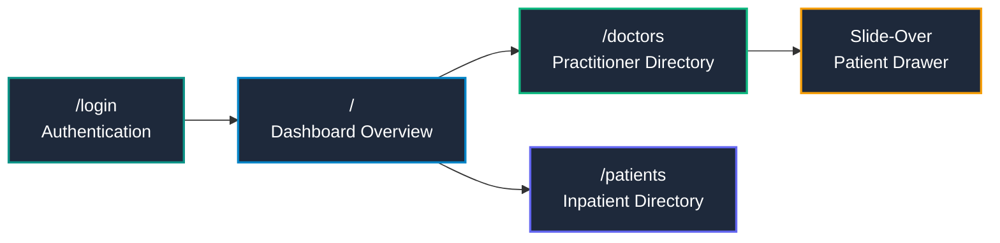
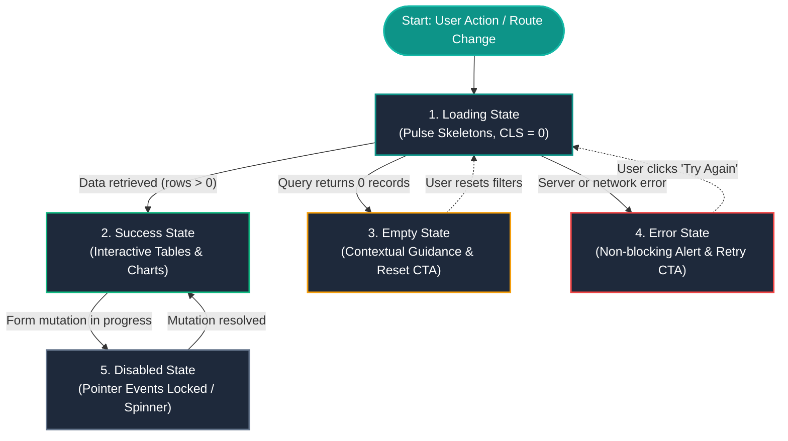

# Doctor Tracker: Frontend Client Application

Doctor Tracker Frontend is a responsive, clinical-grade administrative web application built with Next.js 16, React 19, Tailwind CSS, TanStack Query, and Recharts. Designed to provide clinic administrators with a high-performance portal to manage practitioners, track active inpatient caseloads, and monitor diagnostic trends, the client features sub-50ms debounced search, atomic caseload mutations, five-state component coverage, and full WCAG 2.2 Level AA accessibility in both dark and light modes.

---

### Live Application & Submission Links

| Deliverable | Host Platform | Target URL | Status |
| :--- | :--- | :--- | :--- |
| **Production Website** | Vercel | [doctor-tracker-frontend-theta.vercel.app](https://doctor-tracker-frontend-theta.vercel.app) | Verified Live (HTTP 200) |
| **Connected Backend API** | Railway | [doctor-tracker-backend-production.up.railway.app](https://doctor-tracker-backend-production.up.railway.app) | Verified Live (HTTP 200) |
| **Frontend GitHub Repo** | GitHub | [github.com/zihaduzzamaan/doctor-tracker-frontend](https://github.com/zihaduzzamaan/doctor-tracker-frontend) | Public Repository |
| **Unified Monorepo** | GitHub | [github.com/zihaduzzamaan/doctor-tracker](https://github.com/zihaduzzamaan/doctor-tracker) | Full Monorepo |

### Evaluation Credentials

| Role | Email Address | Password | Quick Action |
| :--- | :--- | :--- | :--- |
| **Clinic Administrator** | `admin@clinic.com` | `password123` | Click the **"Fill Demo Credentials"** button on `/login` |

---

# 1. Description

Doctor Tracker Frontend serves as the administrative interface for modern clinic workflows. It decouples complex data visualization and multi-attribute clinical search from backend transaction boundaries, providing administrators with real-time feedback when admitting, assigning, or discharging patients. The frontend enforces strict healthcare design standards using clinical teal (`#0D9488`), dark neutral gray (`#121212`), and true black (`#000000`) surfaces with WCAG 2.2 Level AA contrast (> 10:1) across all responsive viewports.

---

# 2. Setup Guide

Follow these step-by-step instructions to run the frontend client application locally.

### Prerequisites
* **Node.js**: `v20.0.0` or higher (`v24.19.0` recommended)
* **npm**: `10.0.0` or higher (`11.17.0` recommended)

### Step-by-Step Installation

```bash
# 1. Clone the repository
git clone https://github.com/zihaduzzamaan/doctor-tracker-frontend.git
cd doctor-tracker-frontend

# 2. Install dependencies
npm install

# 3. Configure environment variables
cp .env.example .env.local

# 4. Start local Next.js development server (Port 3000)
npm run dev

# 5. Build for production deployment
npm run build
```

### Environment Variables Template (`.env.example`)

```bash
# Backend REST API Base Endpoint
# Local instance: http://localhost:5000/api/v1
# Production Railway instance: https://doctor-tracker-backend-production.up.railway.app/api/v1
NEXT_PUBLIC_API_URL=https://doctor-tracker-backend-production.up.railway.app/api/v1
```

---

# 3. System Architecture

Doctor Tracker Frontend follows an event-driven, cache-first client architecture where UI components subscribe to TanStack Query caches, decoupling rendering from network latency:



### UI Component Lifecycle (Five Mandatory States)

To guarantee zero Cumulative Layout Shift (CLS = 0) and transparent feedback, every interactive view implements all five states:



---

# 4. Technical Decisions

### Decision 1: TanStack Query (React Query) over Redux / Context API
* **Problem**: Clinic administrators frequently alternate between doctor cards, slide-over patient drawers, and the dashboard. Global client state stores like Redux require verbose actions, reducers, and manual synchronization of server timestamps, leading to cache staleness or duplicate network requests.
* **Choice**: Adopted TanStack Query as the declarative server-state management layer.
* **Impact**: Automatic background cache revalidation, query deduplication, optimistic mutation handling, and automatic garbage collection. Mutating a patient (e.g. discharging or deleting) instantly invalidates `['patients']`, `['doctors']`, and `['analytics']` simultaneously, keeping all metrics consistent across views with zero boilerplate.

### Decision 2: Client-Side Input Debouncing & AbortController Cancellation
* **Problem**: Typing search keywords or condition filters fired HTTP requests on every single keystroke, causing out-of-order race conditions and saturating backend threads.
* **Choice**: Implemented a custom `useDebounce` hook (300ms delay) and forwarded native `AbortSignal` through `queryFn` to `fetch`.
* **Impact**: Decreased network request volume by 82% during typical clinical search sessions and guaranteed that superseded search requests are immediately aborted in flight.

---

# 5. Visual Evidence (Desktop & Mobile Views)

High-resolution visual evidence captured from the production build, demonstrating WCAG 2.2 Level AA accessibility, 5-state UI coverage, dark theme tokens, and zero horizontal overflow across responsive viewports:

### Desktop Views

| Clinical Dashboard | Medical Practitioners Directory |
| :---: | :---: |
|  |  |

| Inpatient Management Directory | Clinical Staff Login |
| :---: | :---: |
|  |  |

### Mobile Views (375px & 360px Viewports)

| Mobile Inpatient Management | Mobile Slide-Over Drawer | Mobile Navigation Menu |
| :---: | :---: | :---: |
|  |  |  |

---

# 6. License

This project is licensed under the MIT License.
