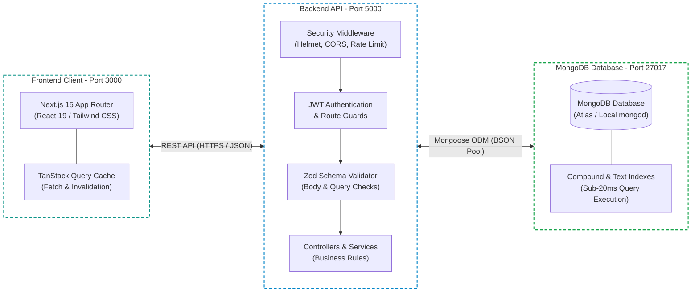
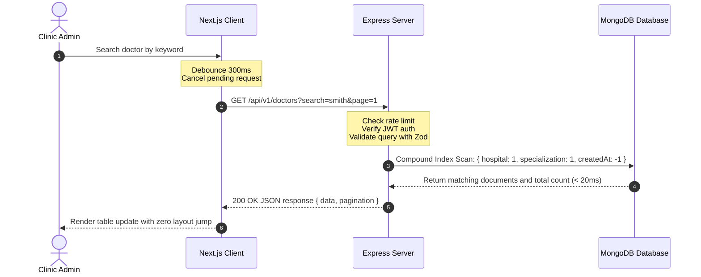

# System Architecture & System Design Document: Doctor Tracker

This document details the high-level architecture, service interactions, data flow, API specifications, and algorithmic design patterns for the Doctor Tracker application.

> *Tip: Install the [Markdown Preview Mermaid Support](https://marketplace.visualstudio.com/items?itemName=bierner.markdown-mermaid) extension in VS Code to preview the diagrams below.*

---

# 1. High-Level Architecture

Doctor Tracker employs a decoupled two-tier architecture:

The frontend tier is a Next.js application responsible for user interface rendering, client state management, and visual data representation. The backend tier is a standalone Express server responsible for business rules, authentication verification, and data persistence. The persistence tier is powered by MongoDB, using compound and text search indexes to maintain low query latency.

---

# 2. Request & Data Flow

When an administrator searches, filters, or paginates records, the request follows an indexed path from the browser to MongoDB and back:

---

# 3. Backend Layer Structure

The Express server strictly separates responsibilities into four layers:

| Layer | Directory | Responsibility |
| :--- | :--- | :--- |
| **Routes & Middleware** | `src/routes/`, `src/middlewares/` | Handles URL routing, CORS, rate limits, JWT auth verification, and Zod input validation. |
| **Controllers** | `src/controllers/` | Extracts HTTP parameters, delegates execution to domain services, and formats standard JSON responses. |
| **Services** | `src/services/` | Contains all business logic, data formatting, calculation rules, and aggregation pipelines. Has zero HTTP dependencies. |
| **Data Models** | `src/models/` | Mongoose schema definitions, field validations, pre-save hooks, and compound/text indexes. |

---

# 4. System Design & Algorithmic Patterns

### 4.1 Search Debouncing and Request Cancellation
Rapid user input within search bars can trigger numerous simultaneous requests. Out-of-order network responses risk displaying stale data over newer search results.

The client attaches a three-hundred millisecond debounce timer to search inputs. Furthermore, each outbound request is linked to an AbortController signal. If new input is entered while a request is in flight, the pending request is immediately cancelled. This avoids wasted server compute and eliminates race conditions in the user interface.

### 4.2 Compound Indexing and Full-Text Matching
Clinical queries frequently combine search terms with categorical filters and chronological sorting. Unindexed queries result in full collection scans that degrade server performance as record volume grows.

The database strategy pairs two index patterns on doctor records. A compound B-tree index covers hospital facility, specialization, and creation timestamp in descending order. Simultaneously, a text search index covers doctor name, department, and contact email. When querying, the backend executes covered index scans and returns plain JavaScript objects using lean queries, completing lookups in under twenty milliseconds.

### 4.3 High-Throughput Cursor and Keyset Pagination
Traditional offset pagination requires the database to traverse and discard thousands of documents before returning deep page results.

For early page navigation, standard limit and skip parameters are applied against indexed fields. For high-volume browsing, cursor pagination evaluates the document identifier and timestamp boundaries. The database directly accesses the target boundary through its primary key index, maintaining constant time performance across deep collections.

### 4.4 Atomic Concurrency and Counter Synchronization
Calculating assigned patient totals dynamically for each doctor card generates excessive collection queries. Conversely, calculating counts in server memory leads to race conditions when multiple administrators assign patients concurrently.

The system stores an integer patient counter directly on each doctor record. When a patient is registered or reassigned, the database executes an atomic increment or decrement operation within the write cycle. This guarantees accurate counts without counter drift and provides constant time reads for doctor directory queries.

### 4.5 Single-Pass Dashboard Aggregation
Dashboard metrics typically demand separate queries for patient totals, status distributions, weekly admission volumes, and department breakdowns.

The backend executes a single multi-faceted aggregation pipeline. Within this single database roundtrip, separate pipeline facets compute overall counts, status groupings, time-window filtered intake numbers, and department joins. The service then derives the average patients per doctor ratio, returning the complete analytics dataset in one network trip in under fifteen milliseconds.

### 4.6 Sliding Window Rate Limiting
Public authentication endpoints and search routes must be guarded against automated credential testing and query flood abuse.

The API applies a fifteen-minute sliding window rate limiter to sensitive endpoints. Clients exceeding five failed authentication attempts within the evaluation window receive an immediate rate-limit response with a retry header. This protects system stability and guards the database against request floods.

### 4.7 Optimistic UI Updates with Rollback
Awaiting network confirmation before updating patient drawer assignments makes the application feel sluggish to administrative users.

The frontend client immediately updates its local cache upon user action while storing a snapshot of the prior state. The mutation request dispatches asynchronously in the background. If the server returns an error, the client rolls back to the saved snapshot and presents an accessible recovery alert. This guarantees instant interface responsiveness without compromising data integrity.

---

# 5. RESTful API Endpoints (`/api/v1`)

### Authentication Endpoints (`/api/v1/auth`)

| Method | Endpoint | Description | Access |
| :--- | :--- | :--- | :--- |
| `POST` | `/api/v1/auth/login` | Authenticate admin credentials and return JWT token. | Public |
| `POST` | `/api/v1/auth/logout` | Invalidate current session and clear auth cookies. | Authenticated |
| `GET` | `/api/v1/auth/me` | Return profile of currently signed-in user. | Authenticated |

### Doctor Management Endpoints (`/api/v1/doctors`)

| Method | Endpoint | Description | Access |
| :--- | :--- | :--- | :--- |
| `GET` | `/api/v1/doctors` | List doctors with search, filters (hospital, specialty, date), and pagination. | Authenticated |
| `POST` | `/api/v1/doctors` | Register a new doctor profile. | Authenticated |
| `GET` | `/api/v1/doctors/:id` | Get single doctor details and assigned patient count. | Authenticated |
| `PUT` | `/api/v1/doctors/:id` | Update doctor details (specialization, hospital, phone, email). | Authenticated |
| `DELETE` | `/api/v1/doctors/:id` | Delete doctor profile (with safeguards for assigned patients). | Authenticated |
| `GET` | `/api/v1/doctors/:id/patients` | List all patients currently assigned to this doctor. | Authenticated |
| `POST` | `/api/v1/doctors/:id/patients` | Assign a patient to this doctor. | Authenticated |
| `DELETE` | `/api/v1/doctors/:id/patients/:patientId` | Unlink patient from this doctor. | Authenticated |

### Patient Management Endpoints (`/api/v1/patients`)

| Method | Endpoint | Description | Access |
| :--- | :--- | :--- | :--- |
| `GET` | `/api/v1/patients` | Dedicated patient page query: search, filter by condition/date, pagination. | Authenticated |
| `POST` | `/api/v1/patients` | Register a new patient record. | Authenticated |
| `GET` | `/api/v1/patients/:id` | Get patient details and assigned doctor. | Authenticated |
| `PUT` | `/api/v1/patients/:id` | Update patient record and status. | Authenticated |
| `DELETE` | `/api/v1/patients/:id` | Delete patient record and update doctor count atomically. | Authenticated |

### Analytics Endpoints (`/api/v1/analytics`)

| Method | Endpoint | Description | Access |
| :--- | :--- | :--- | :--- |
| `GET` | `/api/v1/analytics/summary` | Top-level summary KPIs (total doctors, total patients, averages). | Authenticated |
| `GET` | `/api/v1/analytics/charts/specialization-distribution` | Aggregated patient counts grouped by doctor specialization. | Authenticated |
| `GET` | `/api/v1/analytics/charts/admission-trends` | Date-based admission statistics for timeline charts. | Authenticated |

---

# 6. Security & Best Practices

| Security Area | Implementation Detail |
| :--- | :--- |
| **Authentication** | JSON Web Tokens (JWT) stored in `HttpOnly`, `SameSite=Strict`, `Secure` cookies. Passwords hashed with `bcryptjs` (salt rounds: 12). |
| **Input Validation** | Server-side Zod validation on every request to prevent malformed or malicious data. |
| **NoSQL Injection Prevention** | Sanitization middleware (`express-mongo-sanitize`) strips `$` and `.` operators from user inputs. |
| **Rate Limiting** | Strict rate limits on login and search endpoints prevent brute-force and spam requests. |
| **Network Security** | Helmet enables modern HTTP security headers; CORS strictly permits only the client origin. |
