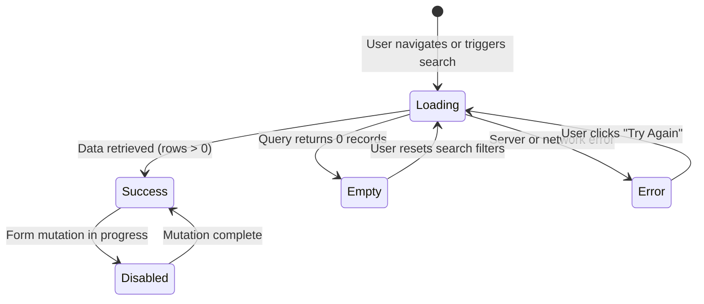

# UI/UX Design System: Doctor Tracker

This document outlines the visual design language, component behavior, and accessibility standards for the **Doctor Tracker** interface.

> *Tip: Install the [Markdown Preview Mermaid Support](https://marketplace.visualstudio.com/items?itemName=bierner.markdown-mermaid) extension in VS Code to preview the diagrams below.*

---

# 1. Design Overview & Theme

Doctor Tracker uses a teal and slate color scheme. The goal is clear readability and low eye strain for clinic staff working across long shifts.

### Interactive State Machine

---

# 2. Color Palette (WCAG 2.2 AA Compliant)

All color pairings guarantee a minimum contrast ratio of 4.5:1 for body text and 3:1 for UI components.

| Token | Color Sample | Hex Value | Usage |
| :--- | :--- | :--- | :--- |
| **Primary (Teal 600)** | Clinical Teal | `#0D9488` | Main action buttons, active navigation, key highlights |
| **Primary Hover** | Deep Teal | `#0F766E` | Hover and focus state on primary elements |
| **Dark Neutral** | Slate 900 | `#0F172A` | Primary text, modal headings, sidebar background |
| **Muted Neutral** | Slate 600 | `#475569` | Secondary captions, timestamps, column headers |
| **Border Neutral** | Slate 200 | `#E2E8F0` | Dividers, card borders, table row borders |
| **App Background** | Slate 50 | `#F8FAFC` | Main application background (low-glare light mode) |
| **Card Surface** | White | `#FFFFFF` | Panels, modals, data tables, dropdown cards |

### Medical Status Badges

| Status | Background | Text Color | Meaning |
| :--- | :--- | :--- | :--- |
| **Critical** | `#FEF2F2` (Red 50) | `#991B1B` (Red 800) | Immediate medical attention needed; destructive actions |
| **Under Observation** | `#FFFBEB` (Amber 50) | `#92400E` (Amber 800) | Patient monitoring in progress; warning alerts |
| **Stable / Active** | `#ECFDF5` (Emerald 50) | `#065F46` (Emerald 800) | Normal condition; active doctor; successful action |
| **Discharged** | `#F1F5F9` (Slate 100) | `#475569` (Slate 600) | Inactive or past patient records |

---

# 3. Typography Scale

Font Stack: `Inter, -apple-system, BlinkMacSystemFont, 'Segoe UI', Roboto, sans-serif`

| Level | Size / Line Height | Weight | Usage |
| :--- | :--- | :--- | :--- |
| **Display Header** | 28px / 36px | SemiBold (600) | Dashboard greeting & top KPI numbers |
| **Page Title** | 22px / 28px | SemiBold (600) | Workspace headers (Doctors & Patients) |
| **Section Title** | 16px / 24px | Medium (500) | Card headers, table section titles |
| **Body Regular** | 14px / 20px | Regular (400) | Table cell data, form labels, paragraph text |
| **Badge / Caption** | 12px / 16px | Medium (500) | Status pills, column titles, timestamps |

---

# 4. Mandatory 5 Component States

Every interactive view, table, and form must handle all five states:

| State | Implementation Rule |
| :--- | :--- |
| **1. Loading** | Use animated skeleton placeholders matching table row heights to prevent layout shift (CLS <= 0.1). Never use full-screen blank spinners. |
| **2. Success** | Display interactive table rows, cards, and charts with clean pagination controls. |
| **3. Empty** | Show an illustration or icon with a clear message (e.g., *"No doctors found for 'Cardiology'"*) and a prominent *"Reset Filters"* button. |
| **4. Error** | Display an alert card explaining the issue in simple language, with an immediate *"Try Again"* action button. |
| **5. Disabled** | Submit buttons reduce opacity to 60%, display an inline spinner, and prevent repeated clicks. |

---

# 5. Screen Layout & Navigation

| View | Route | Key Elements |
| :--- | :--- | :--- |
| **Dashboard** | `/` | 4 KPI cards (Doctors, Patients, Ratio, Admissions), Specialty donut chart, Temporal admission trends line chart. |
| **Doctors** | `/doctors` | Search input, Specialty filter dropdown, Hospital filter dropdown, Paginated doctor table, Slide-out drawer with assigned patient list. |
| **Patients** | `/patients` | Global patient search, Condition filter, Urgency status tabs, Paginated patient table, Edit patient modal, Delete confirmation modal. |
| **Login** | `/login` | Centered authentication card, email & password inputs, error alert, and submit button. |

---

# 6. Accessibility Standards (WCAG 2.2 AA)

| Feature | Standard |
| :--- | :--- |
| **Keyboard Access** | Every action is accessible via `Tab`, `Enter`, and `Space`. `Escape` closes modals and drawers. |
| **Focus Rings** | Visible focus indicator (`ring-2 ring-teal-500 ring-offset-2`) on all interactive controls. |
| **Screen Readers** | Form controls use explicit `<label>` tags. Table updates use `aria-live="polite"`. |
| **Touch Targets** | Minimum target size of 44x44px for buttons and touch controls on mobile devices. |
